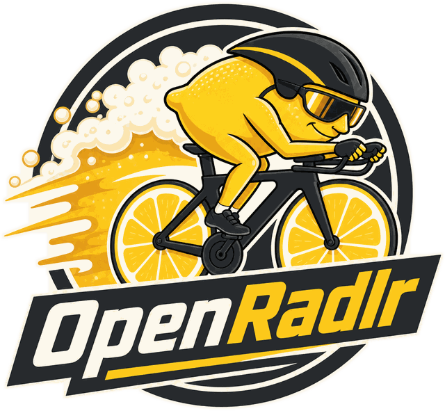
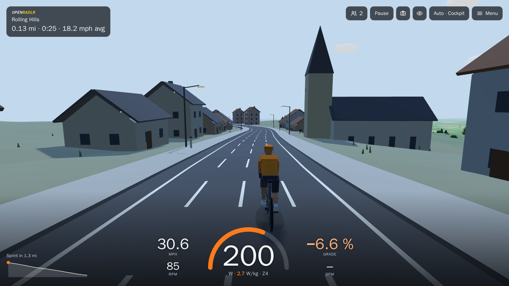
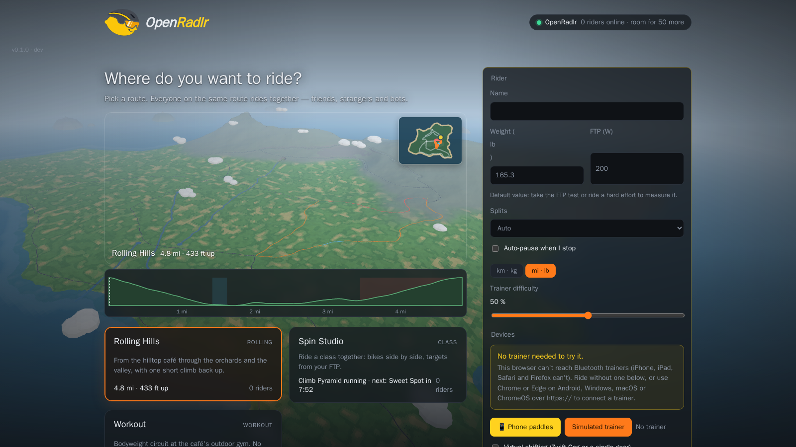

<p align="center">
  
</p>

<h1 align="center">OpenRadlr</h1>

<p align="center">
  Open-source indoor cycling with friends — and bots, so the road is never empty.<br>
  <sub><i>Radler</i> (German): a cyclist. Also half beer, half lemonade — the usual reward afterwards.</sub>
</p>

Hook up a smart trainer, open the browser and ride a virtual route together with
others. Every server is just a Docker container: run it at home for your LAN, on
a VPS for your club, or join a public one. This repository contains the
**proof of concept**: a Rust game server and a browser client (installable as
an app) with a 3D and a 2D view.

<p align="center">
  <a href="https://github.com/Lethonium/OpenRadlr/actions/workflows/ci.yml"></a>
  <a href="LICENSE"></a>
</p>

> Status: proof of concept. Expect breaking changes.

<p align="center">
  
  
</p>

## Quick start

Requirements: Docker with Compose v2 and `make`. Rust and Node are optional.

```bash
make up
```

Then open **http://localhost:8080** in Chrome or Edge, enter a name, connect your
trainer (or pick *Simulated trainer*) and join. The first `make up` copies
`.env.example` to `.env`; adjust it and run `make up` again to apply changes.

| Control | Action |
| --- | --- |
| `←` / `→` or `A` / `D` | change lane |
| `↑` / `↓` or `W` / `S` | simulated trainer power ±10 W |
| `E` / `Q` or `+` / `−` | shift up / down (virtual shifting) |
| `J` | join a race during its countdown / leave it |
| `L` | cycle the HUD layout: auto, cockpit, broadcast, training, race |
| `M` / `Esc` | open the menu (training, race, view, devices) / close panels |
| `V` | switch between 3D and 2D view |
| `C` / `T` | cycle camera (chase, close, drone, TV side) / time of day |
| `P` | take a photo (find them under *Menu → Finish ride*) |
| `↑` / `↓` in ERG mode | target ±5 W, or intensity ±5 % during a workout |

On a phone or tablet the same controls are on screen: lane arrows at the
sides and, with the simulated trainer, a power stepper.

**No trainer? Phone paddles.** Pick *📱 Phone paddles* on the start screen and
tap the left and right paddles in turn, like pedal strokes. A steady rhythm in
the green band holds about 75 % of your FTP; tapping faster sprints up to
150 %, but drains your energy bar, and it refills when you ease off. Tapping
the same side twice is a stumble. Swipe sideways above the paddles to change
lanes. Paddle riders race with everyone and get a 📱 by their name. Paddle
rides stay in OpenRadlr: no Strava upload and no ride files (photos and the
summary card can be saved). Simulated-trainer rides can be downloaded but not
uploaded to Strava.

## What's in the POC

- **Server (Rust)** — authoritative physics at 20 Hz (gravity, rolling resistance,
  air drag), drafting, four lanes, bots with fitness profiles, opt-in races
  with countdown and results, JSON over WebSocket. One world per map, a
  player cap, rate limits, optional "Connect with Strava" (as account and for
  uploads).
- **Browser client** — Web Bluetooth for smart trainers (FTMS and Cycling Power,
  e.g. Wahoo KICKR Core, Van Rysel D500) and heart rate straps, a simulated trainer,
  trainer difficulty, virtual shifting (for Zwift Cog and single-gear setups), a
  ERG mode with structured workouts (built-in presets and `.zwo` import),
  low-poly 3D view with chase camera, a 2D lane view, an elevation profile, a
  minimap, nearby riders, race panel and chat; live player counts in the start
  menu and during the ride; ride photos and a summary image; ride summary with
  `.tcx`/`.gpx`/`.fit` download and Strava upload (as a virtual ride with its climbing), placed on the map in a virtual world off Mallorca;
  power-only trainers and power meters (no resistance control) are supported.
- **Spin studio** — stationary group classes next to the roads: a class starts
  every 30 minutes, riders sit side by side in rooms of 16 (bots fill the
  empty bikes), a coach calls the blocks, targets come from each rider's FTP
  (ERG or own gears) and the room board ranks time on target.
- **Café workouts** — a bodyweight circuit without a bike: pick a preset
  (Full body, Core, Tabata), do timed exercises at the outdoor gym next to the
  start café and watch your avatar do them on the mat, visible to everyone
  passing ([docs/workouts.md](docs/workouts.md)).
- **Scheduled events** — a group ride every hour and a race every two, with a
  lobby; in group rides the strong share power with those behind, and bots are
  matched to the riders ([docs/events.md](docs/events.md)).
- **Shared vehicles** — ride a tandem or a beer bike (up to 9 seats) with
  friends: join with a code, everyone's power is added up, the captain steers
  and bots fill free seats ([docs/vehicles.md](docs/vehicles.md)).
- **Bots** — always marked as bots, ride on their own, chase drafts, race and
  sprint according to their style. They make room as humans join.

Web Bluetooth works in Chromium browsers (Chrome, Edge) on Windows, macOS,
Android and ChromeOS — not in Firefox or Safari/iOS. Without Bluetooth you can
still ride with the simulated trainer.

## Commands

Run `make` to list everything. The most important ones:

| Command | What it does |
| --- | --- |
| `make up` | Build and start in the background, wait until healthy |
| `make down` | Stop and remove the containers |
| `make logs` | Follow the logs |
| `make update` | `git pull`, rebuild, restart, wait until healthy |
| `make test` | All tests (Rust and JavaScript) |
| `make lint` | rustfmt, clippy (`-D warnings`), ESLint |
| `make check` | Everything CI runs |
| `make dev` | Run the server with local cargo, no Docker |
| `make lock` | Create `server/Cargo.lock` — run once and commit it |

If `cargo` or `npm` is not installed, the test and lint targets run them in Docker.

## Deploying to a server

Full guide, including your own reverse proxy and Strava: [docs/deploy.md](docs/deploy.md).

```bash
git clone <your-repo-url> openradlr && cd openradlr
make setup            # creates .env (later: adds new settings to it)
$EDITOR .env          # set OPENRADLR_SERVER_NAME etc.
make up
```

Later, to deploy new commits: `make update`.

The server exposes aggregate Prometheus metrics at `/internal/metrics` for
connected riders, configured rider capacity and community distance totals. The
endpoint contains no rider names, IDs, credentials or request details. The
Monitoring stack scrapes it over the private `openradlr-metrics` Docker
network; its Grafana dashboard also probes the public `/healthz` URL.

**HTTPS:** browsers only allow Web Bluetooth on `https://` pages or on
`http://localhost`. For a public server, point a DNS record at the machine and
set in `.env`:

```bash
COMPOSE_PROFILES=tls
OPENRADLR_DOMAIN=ride.example.org
```

`make up` then also starts Caddy, which obtains a Let's Encrypt certificate and
proxies to the game server. Ports 80 and 443 must be reachable.

**Landing page (optional):** the official server runs a static page on the
main domain and the app on a subdomain (openradlr.com and app.openradlr.com).
Add `landing` to `COMPOSE_PROFILES` and set `OPENRADLR_LANDING_DOMAIN`; see
[docs/deploy.md](docs/deploy.md#landing-page). Without it nothing changes.

**LAN parties:** set `OPENRADLR_HTTP_BIND=0.0.0.0`. Other machines reach the page
via `http://<your-ip>:8080`, but their browsers block Bluetooth on plain HTTP.
Use the TLS profile with a real domain, or for quick tests enable
`chrome://flags/#unsafely-treat-insecure-origin-as-secure` for that address.

## Configuration

All settings live in `.env`; see [`.env.example`](.env.example) for descriptions.

| Variable | Default | Meaning |
| --- | --- | --- |
| `OPENRADLR_SERVER_NAME` | `OpenRadlr` | Name shown to riders |
| `OPENRADLR_ROUTE` | `rolling-hills` | Default route in `routes/` (without `.json`); all routes there can be picked |
| `OPENRADLR_TARGET_RIDERS` | `12` | Humans + bots kept on the road (per route) |
| `OPENRADLR_MAX_PLAYERS` | `50` | Maximum human riders on trainers at the same time, all routes (phone riders not counted) |
| `OPENRADLR_MAX_PADDLE_PLAYERS` | `20` | Maximum riders on phone paddles at the same time, on top of the above |
| `OPENRADLR_MAX_VISIBLE_RIDERS` | `200` | Most riders in one state message; humans first, then the nearest bots |
| `OPENRADLR_PUBLIC_URL` | – | Public address, e.g. `https://ride.example.org` (Strava, allowed origin) |
| `OPENRADLR_TRUST_PROXY` | `false` | Client IPs from `X-Forwarded-For` behind a reverse proxy |
| `OPENRADLR_MAX_CONNECTIONS_PER_IP` | `4` | Game connections per IP |
| `OPENRADLR_MESSAGES_PER_SECOND` | `20` | Message rate limit per connection |
| `OPENRADLR_STRAVA_CLIENT_ID` / `_SECRET` | – | Enable "Connect with Strava" |
| `OPENRADLR_REQUIRE_STRAVA` | `false` | Riders must connect Strava to join |
| `OPENRADLR_ALLOW_SIMULATED_TRAINER` | `true` | Offer the simulated trainer (set `false` in production) |
| `OPENRADLR_ALLOW_PADDLE_MODE` | `true` | Offer phone paddles (tap left/right for power; no Strava, no ride files) |
| `OPENRADLR_PRIVACY_URL` | – | Link to your privacy policy in the start menu |
| `OPENRADLR_ANALYTICS_DOMAIN` / `_SCRIPT` | – | Opt-in Plausible analytics for the client: your site name, and the script URL if you self-host Plausible (off when the domain is empty) |
| `OPENRADLR_STUDIO` | `true` | Host the spin studio (group classes) next to the routes |
| `OPENRADLR_EVENTS` | `default` | Scheduled events: `default`, `off` or the path of an events file ([events](docs/events.md)) |
| `OPENRADLR_EVENT_LOBBY_S` | `600` | Seconds an event's lobby opens before the start |
| `OPENRADLR_TICK_HZ` / `OPENRADLR_BROADCAST_HZ` | `20` / `4` | Simulation and state rate |
| `OPENRADLR_RACE_COUNTDOWN_S` | `30` | Race countdown (time to join) in seconds |
| `OPENRADLR_MAX_RACE_LAPS` | `20` | Upper limit for race laps |
| `OPENRADLR_BOT_SEED` | random | Fixed seed for reproducible bots |
| `OPENRADLR_AUTH_MODE` | `open` | Only `open` (local profiles) in the POC |
| `OPENRADLR_HTTP_BIND` / `OPENRADLR_HTTP_PORT` | `127.0.0.1` / `8080` | Where the web client is published |
| `COMPOSE_PROFILES`, `OPENRADLR_DOMAIN` | – | Enable HTTPS via Caddy (`tls`), the landing page (`landing`) |
| `OPENRADLR_LANDING_DOMAIN` / `_URL` | – | Domain(s) and address of the landing page |
| `RUST_LOG` | `info` | Log level |

## Project layout

```text
.
├── server/                 Rust workspace
│   ├── crates/sim/         simulation core: route, physics, drafting, bots, races (no dependencies)
│   └── crates/server/      network adapter: config, protocol, game loop, HTTP/WebSocket
├── client/
│   ├── public/             browser client (plain ES modules, no build step)
│   └── test/               client unit tests (node:test)
├── routes/                 route files (JSON), shared by server and clients
├── landing/                landing page for the main domain (Astro, static)
├── deploy/Caddyfile        HTTPS reverse proxy
├── docs/                   architecture, protocol, devices, decisions
├── Dockerfile, docker-compose.yml, Makefile, .env.example
└── .github/workflows/ci.yml
```

## Documentation

- [Architecture](docs/architecture.md) — components, layers, how a tick works
- [Protocol](docs/protocol.md) — every WebSocket message
- [Events](docs/events.md) — group rides, races, power sharing, events file
- [Vehicles](docs/vehicles.md) — tandems and beer bikes, codes, captain, bots
- [Workouts](docs/workouts.md) — café circuits, presets, exercises, history
- [Devices](docs/devices.md) — FTMS, heart rate, Zwift Click/Play/Ride controllers
- [Routes](docs/routes.md) — route file format
- [Deploying](docs/deploy.md) — production behind a reverse proxy, Strava, limits
- [Decisions](docs/adr/) — architecture decision records
- [Contributing](CONTRIBUTING.md) — workflow, TDD, conventions
- [Code of conduct](CODE_OF_CONDUCT.md) and [security policy](SECURITY.md)

## License

- **Code:** [GNU AGPL v3 or later](LICENSE). You can use, change and host
  OpenRadlr freely, also commercially. If you run a **modified** server for
  other people, you must offer them its source code under the same licence.
- **Artwork** (logo, icons, screenshots): [CC BY-SA 4.0](ASSETS-LICENSE.md).
- **Name and logo:** see [TRADEMARKS.md](TRADEMARKS.md). Forks are welcome, but
  under their own name.

OpenRadlr is an independent project. It is not affiliated with, endorsed by or
sponsored by Zwift, Wahoo, Strava, Van Rysel or any other company named here;
their names only say which products it works with, and they belong to their
owners.
