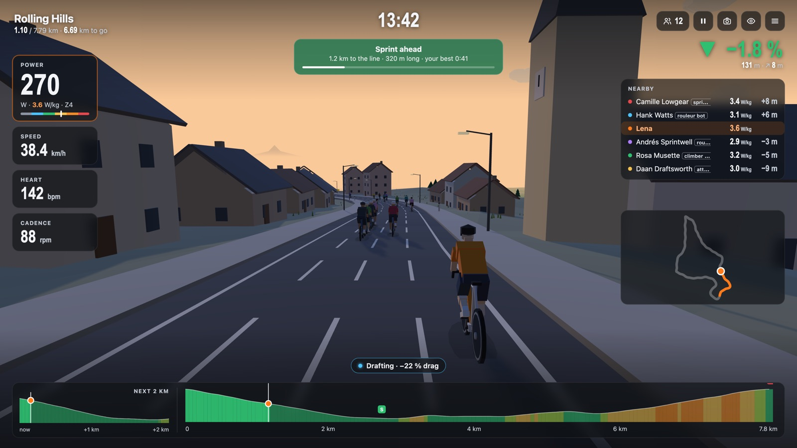
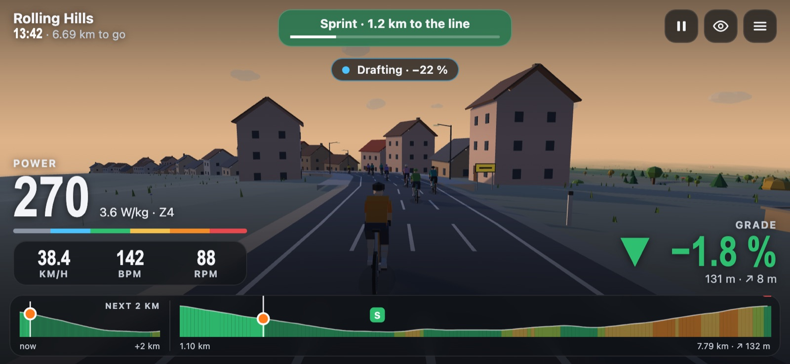
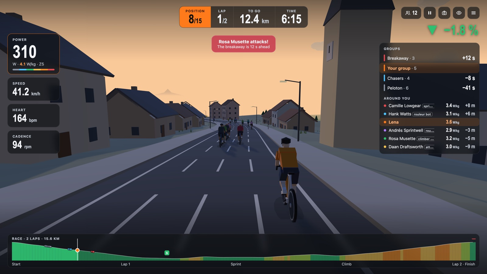

# Ride screen redesign

A cleaner ride screen: every piece of information has one fixed place, and the middle of the screen
belongs to the road. Follows the phone (#79) and tablet/desktop (#84) layout fixes, and replaces the
race layout follow-up planned there.

## Intent

The ride screen grew one feature at a time. Today it has four layouts (`view/hud.js` `LAYOUTS`:
Cockpit, Broadcast, Training, Race), and each repeats the same metrics in its own arrangement:

- **Cockpit**, the default for free rides, puts the power gauge in the middle of the road, right behind
  the rider. Speed, cadence, grade and heart rate sit beside it, the info box at the top left, the
  status pills and notices in a column of their own, the ticker under the info box.
- **Broadcast** has nearby riders, the map and the lap profile, but only when chosen by hand.
- **Race** shows position, lap and a race timeline, but no elevation profile, so a rider can't see
  where the climb is or how far the groups are apart on the road.

Other indoor cycling apps (Zwift, Rouvy, VeloPopuli and others) share a few rules our screen breaks:

- **One hero number:** power, large; everything else small and uniform.
- **Metrics in one place:** a tile column or one bar, not spread across the screen.
- **Route context at the edges:** the gradient large in a corner, the elevation profile along the
  bottom, coloured by steepness, with your position.
- **Others compact on one side:** dot, name, W/kg, gap.
- **Few, small buttons.**
- **A clear centre** with the scene, and one banner at the top when something happens.

## Goals

- One default ride screen for free rides, on desktop, tablet and phone (portrait and landscape).
- A colour-coded elevation profile at the bottom: the whole lap, plus the next 2 km on wider screens.
- The gradient large and colour-coded at the top right.
- Power as the hero tile with W/kg, zone and a zone bar.
- Nearby riders with W/kg on the right, the map below them.
- One banner slot for everything that happens (sprint ahead, climb, race call, junction…).
- Race extras: a race bar (position, lap, to go, time), the groups with their gaps, and all racers
  on the profile.
- A *Minimal* view: power, gradient and profile only.

## Non-goals

- The workout layout (Training) and the spin studio. They keep their own screens; aligning Training
  with the new tiles is a later step.
- New data. Everything shown exists today: route, markers, `raceStanding` groups and gaps, drafting,
  ghost gap, nearby riders, goals line, notices.
- The second screen cockpit (#88). The phone cockpit is the rider's own arrangement and stays as it is.
- 3D scene, camera and lighting.
- The start menu and the in-game menu.

## Anti-goals

- A dashboard wall. If a number isn't needed while pedalling, it goes in the menu (Overview has the
  live ride stats).
- Notices that pile up. One banner at a time, the most urgent first.
- Colour as the only signal. The gradient also has an arrow and a sign; the zone also has its number.

## Constraints

- Client only, plain ES modules, no build step (`client/public/`). UI text in `i18n/en.js` and
  `de.js` (ADR 0017).
- Pure logic in `view/hud.js` and the canvas views, tested with `node --test`. The DOM stays thin
  (`MetricBinder`, `data-m`).
- Same breakpoints as #79 and #84: phone is `max-width: 760px` or `max-height: 500px`; tablet and
  desktop above.
- No overlaps or cut-off text on any of the 116 sizes and states of the #79/#84 audit (72 phone and
  touch, 44 tablet and desktop), with every notice forced visible at once.
- Contrast WCAG AA for text on the glass panels over the brightest scenes (golden hour, snow).
- Metric and imperial units everywhere (`util/format.js`).
- Only the visible canvases are drawn each frame, as today.

## Approaches

How the layouts are organised.

1. **One default screen with *Minimal* as the only alternative; race and workout add their extras.**
   Cockpit and Broadcast merge into one *Ride* screen. *Auto* still switches to Race and Training.
   **Recommended:** one place per piece of information, half the CSS and markup, and one screen to
   audit instead of two.
2. Keep Cockpit and Broadcast, and redesign each. Riders keep both choices, but every metric still
   exists twice, and the two still drift apart.
3. Let riders arrange tiles themselves, as on the phone cockpit (#88). Most flexible, but too much
   for the main screen. The phone cockpit already offers that for anyone who wants it.

## Design

The mockups below are drawn over real OpenRadlr scenes with the real Rolling Hills profile, in our
fonts and glass style. They show the arrangement, not every pixel.

### Desktop and tablet: free ride

| Place | Content | Today |
| --- | --- | --- |
| Top left | Route name; distance done / lap length · km to go in the lap; the goals line (#102) and vehicle line below, when present | info box with brand, distance, time, average speed |
| Top centre | Ride time, large; below it **one** banner slot | no timer in Cockpit; notices in their own column |
| Top right | Icon buttons (riders with count, pause, photo, view, menu), each with a tooltip and `aria-label`; below them the **gradient**, large, with arrow and colour, then altitude and metres climbed | buttons with text; gradient inside the gauge |
| Left | Tile column: **power** (hero: W, W/kg, zone, zone bar with a marker; with ERG the target as a tick on the bar and "→ 250 W"); then speed, heart rate, cadence; the gear tile (virtual shifting) under them when shown | gauge in the middle of the road |
| Left, below the tiles | Ticker (bot moves, #64), at most three lines | under the info box |
| Right | **Nearby**: coloured dot, name, bot badge, W/kg, gap; me highlighted in the middle; at most seven rows. The route map below it | Broadcast only |
| Bottom | Profile strip: the **next 2 km** on the left, the **whole lap** on the right, both coloured by gradient; sprint and climb marked; my position as a dot and line | 2 km in Cockpit, one-colour lap in Broadcast |
| Above the profile, centre | At most two status pills: drafting first, then the ghost gap or group gap | pills wherever space allowed |
| Centre | Nothing but the scene | gauge |

The *Free ride* pill goes away: a ride without the race bar is a free ride. *Power only* moves to the power tile as
a small note ("power only: the road won't change resistance"), shown while it applies.

### The banner slot

One notice at a time, under the timer (in a race, under the race bar). Highest priority wins; the others wait
their turn and are not lost:

1. Junction choice (needs input).
2. Race call and event call (with their *Join* button).
3. Sprint or climb countdown, inside the last 1 km and while inside the segment, with a progress bar.
   In a race, attacks of riders in my group or the group ahead (`bots.attack`, #64).
4. Milestone.
5. Split toast.

The colour follows the kind: green for sprint and positive news, red for a climb or attack, neutral glass
for calls. The priority is a pure function in `view/hud.js` (`bannerFor(notices)`), so it is tested
without the DOM. It replaces the CSS `:has()` priority and the notices column from #79 and #84,
which also settles #103 (repeated column rules) and #104 (fixed `--top-stack` heights): the column
no longer exists.

### Colours

- **Gradient:** one scale shared by the gradient number and both profiles. Downhill and flat
  green, then yellow from 3 %, orange from 6 %, red from 9 %, dark red from 12 %. One function
  (`gradeColor(percent)`) in `view/canvas.js`, next to `riderColor`.
- **Power zones:** the six zones of `zoneFor`, in the workout chart's `ZONE_COLORS`
  (`view/workoutView.js`): grey, blue, green, yellow, orange, red.
- Panels: today's glass tokens; the tiles use the same panel as Nearby.

### Phone, portrait

Only what you need while riding:

- **Top:** route name; ride time · km to go; the icon buttons for riders, pause, view and menu
  (the mockup leaves out riders). Taking a photo moves into the View popover on phones.
- **Under them:** the banner slot, then one pill (drafting).
- **Bottom:** power large on the left, the gradient on the right with W/kg and zone under it; the
  zone bar across; speed, heart rate and cadence in one row; the whole-lap profile at the very
  bottom, labelled with distance done, lap length and metres climbed.
- Nearby riders and the map stay behind the riders button.
- Lane buttons and the simulated trainer's stepper keep their places from #79, above the metrics.

### Phone, landscape

The same pieces spread across the width: route and time top left, the banner in the middle, the
buttons on the right (as in portrait). Power with the zone bar and the speed · heart rate · cadence row bottom left,
the gradient bottom right, the profile strip (2 km and lap) along the bottom edge.

### Minimal

The buttons, the ride time, the banner slot, the power tile, the gradient and the profile strip. No tiles beyond
power, no Nearby, no map, no ticker, no pills except drafting. For riders who want to see the road.

### Race

Shown by *Auto* while I'm in a race that is counting down or running (`chooseLayout`, unchanged).

- **Top centre:** the race bar instead of the timer: **Position** (highlighted, "8/15"), **Lap**
  ("1/2"), **To go**, **Time**. The banner slot moves under it.
- **Top left:** empty: the route card is hidden in a race; the race bar has what matters.
- **Right:** **Groups** with a colour bar, name, size and time gap (`raceStanding`: leaders, chase,
  your group, behind; "Breakaway · 3 +12 s"), my group highlighted. Under it **Around you**, the same
  rows as Nearby. The map is hidden in a race.
- **Bottom:** the **race profile**: the whole race distance (all laps) coloured by gradient, every
  racer as a small dot in their group's colour, me as the large dot. Labels for start, each lap,
  sprint, climb and finish. It replaces the race timeline (`raceTimelineView.js`), which showed the
  same order without the terrain.
- Left tiles, gradient and buttons as in free ride.
- On a phone: the race bar replaces the time line at the top; the groups go behind the riders
  button; the profile shows the racers.

### View choices

The View popover and the menu's View page offer *Auto*, *Ride*, *Minimal*, *Training* and *Race*.
*Auto* behaves as today (race beats workout beats free ride), with *Ride* in place of Cockpit. A
remembered *Cockpit* or *Broadcast* becomes *Ride*. The layout key (`L`) cycles through the same
list.

## What changes in the code

- `view/hud.js`: `LAYOUTS` becomes `ride`, `minimal`, `training`, `race`; `chooseLayout` returns `ride`
  for free rides; `bannerFor` (new); the gauge maths go (`gaugeFraction`), the zone maths stay.
- `view/canvas.js`: `gradeColor` (new).
- `view/profileView.js`: `paintProfile` and `drawUpcoming` colour by gradient; the race profile
  over several laps with racers (new, replaces `raceTimelineView.js`).
- `index.html` and `styles.css`: the Cockpit and Broadcast blocks merge into one; the notices
  column becomes the banner slot; the race block is rebuilt on the shared pieces. One copy of each
  metric where possible, so `data-m` copies shrink.
- `main.js`: draws the canvases of the visible layout (profile strip on Ride, Minimal and Race; map
  on Ride), and feeds the banner slot.
- `i18n`: new labels in English and German; old layout names removed.
- `docs/architecture.md` (*Ride screen*): the layout table and notices rules.

## Build order

1. **This spec** with the mockups.
2. **PR 1, the Ride screen:** `gradeColor`, the coloured profiles, the tile column, the banner slot,
   Nearby with W/kg, the icon buttons, *Minimal*, the phone layouts; Cockpit and Broadcast removed.
   Audit all 116 screens and both phone orientations on the Android emulator, app and Chrome.
3. **PR 2, the race extras:** the race bar, the groups panel, the race profile with racers, attack
   banners; the race timeline removed. Same audit with a running race.
4. Later: Training on the same tiles and profile strip.

Each PR updates the README screenshot it changes.

## Testing

- Pure functions with `node --test`: `chooseLayout` (renamed layouts, remembered old names),
  `bannerFor` (priority, waiting notices come back), `gradeColor` (thresholds, downhill), the race
  profile's scale over several laps, Nearby rows with W/kg.
- Playwright audit (as in #79 and #84): overlaps, cut-off text and contrast on every size, in free
  ride, *Minimal*, race and with every notice at once.
- On a device: the Android app and Chrome on the emulator, portrait and landscape; touch controls
  (lanes, stepper) still reachable.

## Left to the builder

- Exact sizes, gaps and font steps, within the type scale from #79.
- Whether the 2 km zoom fits on tablets in portrait, or the lap profile takes the whole width there.
- How long a waiting notice stays queued before it is dropped (a split toast from a minute ago is
  stale).
- The icon set for the buttons (inline SVG, as the lane buttons).

## Decisions to confirm

- **One *Ride* screen plus *Minimal*** (approach 1), instead of keeping Cockpit and Broadcast.
- **W/kg in Nearby**, not watts: it compares riders of different weight fairly. Watts stay in the
  rider's own power tile.
