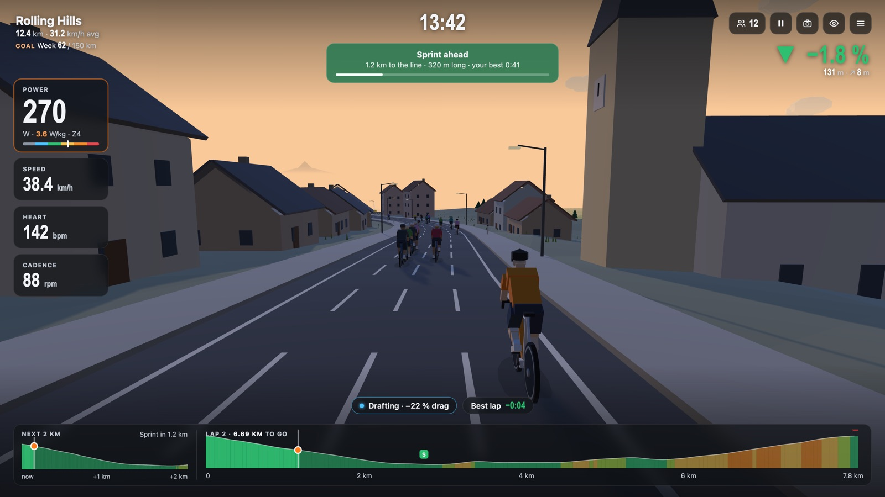
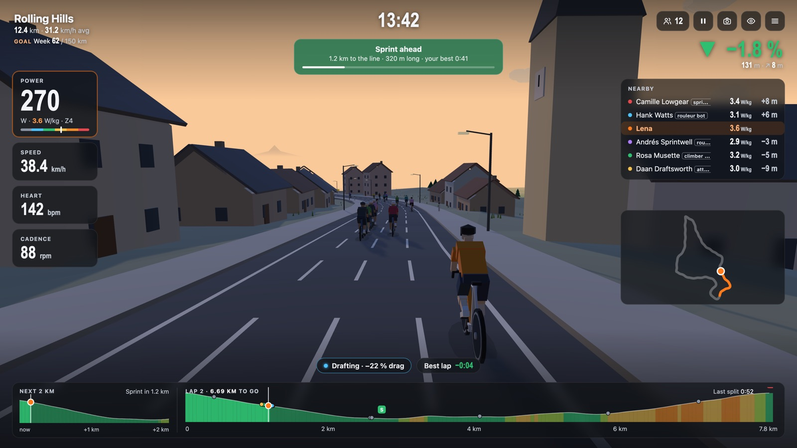
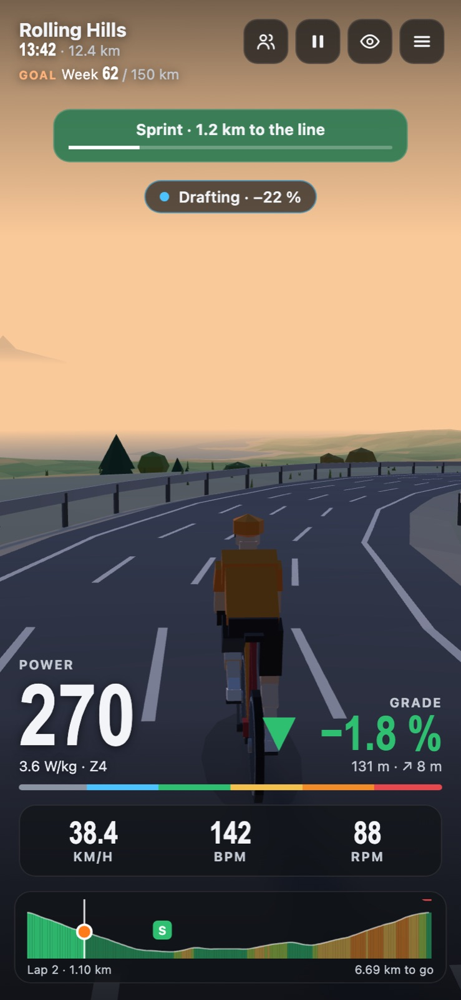

# Ride screen redesign

A cleaner ride screen: every piece of information has one fixed place, and the middle of the screen
belongs to the road. Follows the phone (#79) and tablet/desktop (#84) layout fixes, and replaces the
race layout follow-up planned there.

## Intent

The ride screen grew one feature at a time. It has four layouts (`view/hud.js` `LAYOUTS`), and each
serves its own purpose:

| Layout | For | Shows today |
| --- | --- | --- |
| Cockpit | free riding, the default: how hard am I working, what is the road doing | power gauge (W, W/kg, zone, ERG target), speed, cadence, grade, heart rate; the next 2 km with the next sprint or climb |
| Broadcast | everything at a glance, where everyone is, TV style | metric bar, Nearby, map, lap strip with **all riders**, next marker, lap, last split |
| Training | a workout | targets, workout chart, block and workout time, average power |
| Race | a race I'm in | position, lap, race timeline, to go, groups and gaps, riders around me, sprint/KOM banner |

The purposes are right. The arrangement is the problem:

- Each layout places the same things somewhere else, so nothing has a fixed place.
- Cockpit puts the gauge in the middle of the road, right behind the rider.
- The things every layout shares (info box, status pills, notices, goal line, ticker) compete for
  the space the layouts leave free. #79 and #84 fixed the overlaps with a notices column and fixed
  heights per layout; #103 and #104 are the follow-ups to that.
- Race has no elevation profile, so a rider can't see where the climb is or how far apart the
  groups are on the road.

Other indoor cycling apps (Zwift, Rouvy, VeloPopuli and others) share a few rules our screen breaks:

- **One hero number:** power, large; everything else small and uniform.
- **Metrics in one place:** a tile column or one bar, not spread across the screen.
- **Route context at the edges:** the gradient large in a corner, the elevation profile along the
  bottom, coloured by steepness, with your position.
- **Others compact on one side:** dot, name, W/kg, gap.
- **Few, small buttons.**
- **A clear centre** with the scene, and one banner at the top when something happens.

## Goals

- **Shared areas:** fixed places for what every layout shows (route card with the goal line, time,
  banner slot, pills, buttons, gradient), which no layout uses for anything else.
- **Layout areas:** the left column, the right column and the bottom strip. Each layout fills them
  for its purpose, and only them.
- Cockpit, Broadcast and Race rebuilt on these areas, keeping everything each shows today (table in
  [Where everything goes](#where-everything-goes)).
- A colour-coded elevation profile at the bottom: the next 2 km and the whole lap.
- The gradient large and colour-coded at the top right.
- Power as the hero tile with W/kg, zone and a zone bar.
- One banner slot for everything that happens (sprint ahead, climb, race call, junction…), with a
  tested priority.
- Race: a race bar (position, lap, to go, time), the groups with their gaps, and all racers on a
  profile over the whole race.

## Non-goals

- Training's own content and the spin studio. Training moves onto the shared areas (banner, pills,
  buttons), but its targets and workout chart stay as they are; putting them into the layout areas
  is a later step.
- New data. Everything shown exists today: route, markers, `raceStanding` groups and gaps, drafting,
  ghost gap, nearby riders, goal line, notices.
- The second screen cockpit (#88). The phone cockpit is the rider's own arrangement and stays as it is.
- 3D scene, camera and lighting.
- The start menu and the in-game menu.

## Anti-goals

- A dashboard wall. Cockpit stays the focused default; the full view is a choice.
- Notices that pile up. One banner at a time, the most urgent first.
- Colour as the only signal. The gradient also has an arrow and a sign; the zone also has its number.

## Constraints

- Client only, plain ES modules, no build step (`client/public/`). UI text in `i18n/en.js` and
  `de.js` (ADR 0017).
- Pure logic in `view/hud.js` and the canvas views, tested with `node --test`. The DOM stays thin
  (`MetricBinder`, `data-m`).
- Same breakpoints as #79 and #84: phone is `max-width: 760px` or `max-height: 500px`; tablet and
  desktop above.
- No overlaps or cut-off text on any of the 116 sizes and states of the #79/#84 audit (72 phone and
  touch, 44 tablet and desktop), with every notice forced visible at once.
- Contrast WCAG AA for text on the glass panels over the brightest scenes (golden hour, snow).
- Metric and imperial units everywhere (`util/format.js`).
- Only the visible canvases are drawn each frame, as today.

## Approaches

How the layouts are organised.

1. **Shared areas plus layout areas; the four layouts keep their purposes.** Cockpit stays the
   default. **Recommended:** nothing a layout is for gets lost, the shared things have one place in
   every layout (which removes the notices column and its fixed heights), and the CSS is one grid
   instead of four arrangements.
2. One *Ride* screen replacing Cockpit and Broadcast, with a *Minimal* option (the first draft of
   this spec). Less to build, but the default would get much fuller than Cockpit is today, and
   Broadcast's view of the whole field would get lost.
3. Let riders arrange tiles themselves, as on the phone cockpit (#88). Most flexible, but too much
   for the main screen. The phone cockpit already offers that for anyone who wants it.

## Design

The mockups are drawn over real OpenRadlr scenes with the real Rolling Hills profile, in our fonts
and glass style. They show the arrangement, not every pixel.

### The areas

| Area | Kind | Content |
| --- | --- | --- |
| Top left | shared | Route card: route name; ride distance · average speed; the goal line (#102); the vehicle line when in a vehicle |
| Top centre | shared | Ride time, large (Race: the race bar in its place) |
| Under the top centre | shared | The **banner slot**: one notice at a time |
| Top right | shared | Icon buttons (riders with count, pause, photo, view, menu), each with a tooltip and `aria-label`; under them the **gradient**, large, with arrow and colour, then altitude and metres climbed |
| Above the bottom strip, centre | shared | At most two status pills: drafting first, then the ghost gap or group gap |
| Left column | layout | Cockpit, Broadcast, Race: the metric tiles. Under them the ticker (bot moves, #64), at most three lines |
| Right column | layout | Broadcast: Nearby and the map. Race: Groups and Around you. Cockpit: empty |
| Bottom strip | layout | Cockpit, Broadcast: the next 2 km and the lap. Race: the race profile |
| Centre | none | Nothing but the scene |

The *Free ride* pill goes away: a ride without the race bar is a free ride. *Power only* moves to the
power tile as a small note ("power only: the road won't change resistance"), shown while it applies.

### Cockpit (default for free rides)

Focused on the rider's own effort and the road:

- **Left:** tile column with **power** as the hero (W, W/kg, zone, zone bar with a marker; with ERG
  the target as a tick on the bar and "→ 250 W"), then speed, heart rate, cadence. The gear tile
  (virtual shifting) goes under them when shown.
- **Right:** empty, so the road and the pack stay in view.
- **Bottom:** the **next 2 km** on the left, with the next sprint or climb ("Sprint in 1.2 km"); the
  **lap** on the right ("Lap 2 · 6.69 km to go"), with my position. Both coloured by gradient;
  sprint and climb marked.

### Broadcast

Everything at a glance, chosen in View:

- **Left:** the same tiles as Cockpit.
- **Right:** **Nearby** (coloured dot, name, bot badge, W/kg, gap; me highlighted in the middle; at
  most seven rows), the **map** under it.
- **Bottom:** as Cockpit, but the lap shows **every rider** as a dot in their colour, and the last
  split, as Broadcast's strip does today.

### The banner slot

One notice at a time, under the time (in a race, under the race bar). Highest priority wins; the
others wait their turn:

1. Junction choice (needs input).
2. Race call and event call (with their *Join* button).
3. Sprint or climb countdown, inside the last 1 km and while inside the segment, with a progress bar
   (today only in Race; now in every layout). In a race, attacks of riders in my group or the group
   ahead (`bots.attack`, #64).
4. Milestone.
5. Split toast.

The colour follows the kind: green for a sprint and good news, red for a climb or an attack,
neutral glass for calls. The priority is a pure function in `view/hud.js` (`bannerFor(notices)`),
tested without the DOM. It replaces the CSS `:has()` priority and the notices column from #79 and
#84, which settles #103 (repeated column rules) and #104 (fixed `--top-stack` heights): the column
no longer exists.

### The goal line

The goal line from #102 ("Goal · Week 62 / 150 km", one goal at a time) stays in the route card, in
every layout but Race, on desktop and phones. As #102 decided, it isn't shown in a race or an event
(`hudGoalLines(…, { racing })`), so the race mockup has none. Training keeps it in the workout chip,
as today.

### Colours

- **Gradient:** one scale shared by the gradient number and every profile. Downhill and flat
  green, then yellow from 3 %, orange from 6 %, red from 9 %, dark red from 12 %. One function
  (`gradeColor(percent)`) in `view/canvas.js`, next to `riderColor`.
- **Power zones:** the six zones of `zoneFor`, in the workout chart's `ZONE_COLORS`
  (`view/workoutView.js`): grey, blue, green, yellow, orange, red.
- Panels: today's glass tokens; the tiles use the same panel as Nearby.

### Phone, portrait

Only what you need while riding:

- **Top:** route name; ride time · distance; the goal line; icon buttons for riders, pause, view and
  menu. Taking a photo moves into the View popover on phones.
- **Under them:** the banner slot, then one pill (drafting).
- **Bottom:** power large on the left with W/kg and zone, the gradient on the right; the zone bar
  across; speed, heart rate and cadence in one row; the lap profile at the very bottom ("Lap 2 ·
  1.10 km", "6.69 km to go").
- Broadcast on a phone shows every rider on the lap profile; Nearby and the map stay behind the
  riders button (no room beside the road).
- Lane buttons and the simulated trainer's stepper keep their places from #79, above the metrics.

### Phone, landscape

The same pieces spread across the width: route, time and goal top left, the banner in the middle,
the buttons on the right. Power with the zone bar and the speed · heart rate · cadence row bottom
left, the gradient bottom right, the bottom strip (2 km and lap) along the bottom edge.

### Race

Shown by *Auto* while I'm in a race that is counting down or running (`chooseLayout`, unchanged).

- **Top centre:** the race bar in place of the time: **Position** (highlighted, "8/15"), **Lap**
  ("1/2"), **To go**, **Time**. The banner slot moves under it.
- **Top left:** the route card is hidden; the race bar has what matters, and goals aren't shown in
  races.
- **Right:** **Groups** with a colour bar, name, size and time gap (`raceStanding`: leaders, chase,
  your group, behind), my group highlighted. Under it **Around you**, the same rows as Nearby.
- **Bottom:** the **race profile**: the whole race distance (all laps) coloured by gradient, every
  racer as a small dot in their group's colour, me as the large dot. Labels for start, each lap,
  sprint, climb and finish. It replaces the race timeline (`raceTimelineView.js`), which showed the
  same order without the terrain.
- Left tiles, gradient and buttons as in free ride.
- On a phone: the race bar replaces the time line at the top; the groups go behind the riders
  button; the profile shows the racers.

### Where everything goes

| Today | Layout today | New place |
| --- | --- | --- |
| Power gauge: W, W/kg, zone, ERG target | Cockpit | Power tile: W, W/kg, zone, zone bar, target tick |
| Speed, cadence, heart rate | all | Tiles under power |
| Grade | all | Top right, large |
| Road ahead (2 km) and next marker | Cockpit | Bottom strip, left |
| Metric bar | Broadcast | Tiles |
| Nearby | Broadcast | Right column (Broadcast) |
| Map | Broadcast | Right column (Broadcast) |
| Lap strip with all riders | Broadcast | Bottom strip, right; all riders in Broadcast |
| Lap info and last split | Broadcast | Bottom strip header |
| Distance, time, average speed | info box | Route card and top centre |
| Goal line | info box | Route card |
| OpenRadlr brand | info box | Dropped on the ride screen (it stays on the start menu) |
| Status pills | notices column | Pills above the bottom strip; *Free ride* dropped, *Power only* in the power tile |
| Junction, race and event calls, milestone, split | notices column | Banner slot |
| Sprint/KOM banner | Race | Banner slot, every layout |
| Ticker | under the info box | Under the tiles |
| Position, lap, to go | Race | Race bar |
| Race timeline | Race | Race profile |
| Groups, around you | Race | Right column (Race) |

### View choices

Unchanged: *Auto*, *Cockpit*, *Broadcast*, *Training* and *Race* in the View popover and the menu's
View page, and `L` cycles through them. *Auto* picks Race, then Training, then Cockpit, as today.

## What changes in the code

- `view/hud.js`: `bannerFor` (new); the gauge maths go (`gaugeFraction`), the zone maths stay.
- `view/canvas.js`: `gradeColor` (new).
- `view/profileView.js`: `paintProfile` and `drawUpcoming` colour by gradient; riders on the lap
  only in Broadcast; the race profile over several laps with racers (new, replaces
  `raceTimelineView.js`).
- `index.html` and `styles.css`: the shared areas as one grid; Cockpit, Broadcast and Race fill the
  layout areas; one copy of each metric where possible, so `data-m` copies shrink. The notices
  column becomes the banner slot.
- `main.js`: draws the canvases of the visible layout, and feeds the banner slot.
- `i18n`: new labels in English and German.
- `docs/architecture.md` (*Ride screen*): the areas, the layout table and the banner rules.

## Build order

1. **This spec** with the mockups.
2. **PR 1, free ride:** the shared areas, the banner slot, `gradeColor`, the coloured profiles, the
   tiles; Cockpit and Broadcast rebuilt on them; the phone layouts. Training moves onto the shared
   areas. Audit all 116 screens and both phone orientations on the Android emulator, app and Chrome.
3. **PR 2, race:** the race bar, the groups panel, the race profile with racers, attack banners; the
   race timeline removed. Same audit with a running race.
4. Later: Training's targets and chart in the layout areas.

Each PR updates the README screenshot it changes.

## Testing

- Pure functions with `node --test`: `bannerFor` (priority, waiting notices come back), `gradeColor`
  (thresholds, downhill), the race profile's scale over several laps, Nearby rows with W/kg,
  `hudGoalLines` still empty in a race.
- Playwright audit (as in #79 and #84): overlaps, cut-off text and contrast on every size, in each
  layout and with every notice at once.
- On a device: the Android app and Chrome on the emulator, portrait and landscape; touch controls
  (lanes, stepper) still reachable.

## Left to the builder

- Exact sizes, gaps and font steps, within the type scale from #79.
- Whether the 2 km zoom fits on tablets in portrait, or the lap profile takes the whole width there.
- How long a waiting notice stays queued before it is dropped (a split toast from a minute ago is
  stale).
- The icon set for the buttons (inline SVG, as the lane buttons).

## Decisions to confirm

- **Shared areas with the four layouts kept** (approach 1), instead of one merged *Ride* screen.
- **W/kg in Nearby**, not watts: it compares riders of different weight fairly. Watts stay in the
  rider's own power tile.
